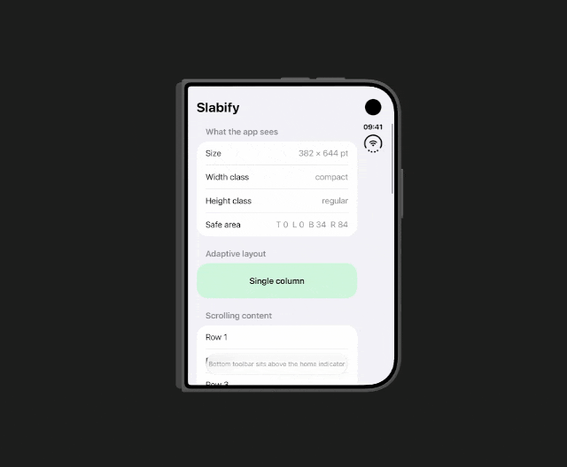

# Slabify

A debug-only Swift package that shows your app inside a resizable, phone-sized frame on iPhone Duo's inner display. Use it to check how your layout behaves at other iPhone sizes without leaving the device.

It only appears on iPhone Duo's inner display. On the outer display, or on other iPhones and iPad, your app runs exactly as usual. Slabify also does nothing in Release builds, so it's safe to leave wired up.



## Features

- **Device presets:** iPhone SE (3rd gen), 16e, 17 / 17 Pro, Air, 17 Pro Max, 18 Pro and 18 Pro Max.
- **Drag to resize:** drag the corner to resize freely.
- **Simulated safe areas:** top and bottom insets match each device.
- **Position:** anchor the phone to the bottom-left or bottom-right corner to use it one-handed with your thumb, like a real phone.
- **Screenshots:** capture the simulated screen alone (like a real iPhone screenshot, with the status bar but no island) or the whole phone with its bezel (add `NSPhotoLibraryAddUsageDescription` to your app's Info.plist to save straight to Photos; otherwise use Save to Files or AirDrop).

## Install

1. In Xcode, choose **File › Add Package Dependencies…** and enter `https://github.com/marcphk/Slabify.git`. Choose **Up to Next Major Version** from **1.0.0**.
2. Add the `Slabify` library to your app target.

## How to use

### SwiftUI (`@main struct MyApp: App`)

Add `.slabify()` to the root view inside `WindowGroup`:

```swift
import SwiftUI
import Slabify

@main
struct MyApp: App {
    @State private var model = AppModel()

    var body: some Scene {
        WindowGroup {
            ContentView()
                .environment(model)
                .slabify()
        }
    }
}
```

### UIKit with a scene delegate

In `SceneDelegate`:

```swift
import Slabify

func scene(_ scene: UIScene, willConnectTo session: UISceneSession, options: UIScene.ConnectionOptions) {
    guard let windowScene = scene as? UIWindowScene else { return }
    let window = UIWindow(windowScene: windowScene)
    window.rootViewController = Slabify.wrap(MyRootViewController())
    window.makeKeyAndVisible()
    self.window = window
}
```

### UIKit with a storyboard

```swift
func scene(_ scene: UIScene, willConnectTo session: UISceneSession, options: UIScene.ConnectionOptions) {
    // ...your existing setup...
    Slabify.install(in: window)
}
```

Your app can replace `window.rootViewController` later (after sign-in, say) without calling it again.

### Objective-C

The package is written in Swift but has an Objective-C entry point, `Slabify`. Make sure **Enable Modules (C and Objective-C)** is on in Build Settings (it is by default). Add the call to your **SceneDelegate** once the window exists:

```objc
@import Slabify;

- (void)scene:(UIScene *)scene willConnectToSession:(UISceneSession *)session options:(UISceneConnectionOptions *)connectionOptions {
    // ...any code that sets up the window's root view controller...

    // Storyboard-based app:
    [Slabify installInWindow:self.window];

    // Or, if you create the root view controller in code:
    // self.window.rootViewController = [Slabify wrapViewController:root];
}
```

## Showing and hiding the frame

Close the frame with the **×** button. To bring it back, there are two options, both on by default:

- **A "Slabify" button** in the top-right corner while the frame is hidden.
- **Swipe up with three fingers, twice**, in quick succession. This also hides the frame. It watches alongside your app's gestures without interfering with them.

If you'd rather nothing sits over your UI even in debug mode, do the following to turn the button off and only use the gesture:

```swift
ContentView().slabify(activation: .threeFingerDoubleSwipe)          // SwiftUI
Slabify.wrap(root, activation: .threeFingerDoubleSwipe)             // UIKit
Slabify.install(in: window, activation: .threeFingerDoubleSwipe)    // storyboards
```

```objc
[Slabify installInWindow:self.window showsButton:NO];            // Objective-C
```

## Demo project

`Demo/SlabifyDemo.xcodeproj` is a small SwiftUI app that displays its size, size classes and safe area, so you can see the frame working. It uses this folder as a local package, so edits to the package show up the next time you run it. Open it, pick your team under Signing & Capabilities if needed, and run it on an unfolded iPhone Duo.

## Limitations

Slabify resizes your app's window and gives it iPhone size classes and safe areas, but the system still knows it's running on the Duo, so:

- **Screen-size APIs** like `UIScreen.main.bounds` or the window scene's size still return the Duo's full size.
- **The keyboard** belongs to the screen, so it won't appear inside the phone.
- **Other windows your app creates** (some libraries use their own) aren't resized, so they appear full screen.
- **The simulated status bar** is approximated.
- **Preset safe-area values** are typical figures.
- **Method swizzling:** in Debug builds, Slabify swaps in its own version of `UIViewController.present(_:animated:completion:)`. It calls the original straight away; it just gives view controllers presented in the framed window the simulated phone's safe areas first. (Nothing is swizzled in Release builds.)

## Requirements

iOS 17+, Swift 5.9+ (Xcode 15 or later).
